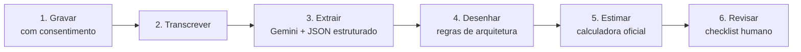

# Da discovery à proposta técnica com IA

Pipeline de pré-vendas que transforma a **transcrição de uma call de discovery** em um **rascunho de proposta técnica** no Google Cloud: dores, requisitos, restrições, decisores, arquitetura de referência em Mermaid e checklist de revisão.

> A IA faz o rascunho. O especialista revisa e assina. Nada vai ao cliente sem revisão humana.

## Fluxo



| Etapa | Arquivo | Como funciona |
|---|---|---|
| Extrair | `extrator.py` | `ExtratorGemini` chama o Gemini com `response_schema` Pydantic, temperatura baixa e instrução de não inventar. `ExtratorRegras` faz o mesmo por palavras-chave, sem IA, para demo e testes. |
| Estruturar | `modelos.py` | `Requisitos` (dores, requisitos, restrições, decisores, prazo, próximos passos) |
| Desenhar | `arquitetura.py` | Regras explícitas mapeiam requisitos para serviços (ex.: LGPD → Sensitive Data Protection + Cloud KMS). Cada componente traz o motivo. |
| Gerar | `proposta.py` | Markdown com diagrama Mermaid, tabela de serviços e checklist. Sem preços: custo é validado na calculadora oficial. |

## Rodar em 1 minuto (sem IA)

```bash
git clone https://github.com/MoniqueSilva79/discovery-para-proposta-ia.git
cd discovery-para-proposta-ia
pip install -r requirements.txt
python proposta.py transcricao_exemplo.txt --offline
```

Veja o resultado em [`exemplo_proposta_rascunho.md`](exemplo_proposta_rascunho.md).

## Rodar com Gemini (Vertex AI)

```bash
export GOOGLE_GENAI_USE_VERTEXAI=TRUE
export GOOGLE_CLOUD_PROJECT=seu-projeto
export GOOGLE_CLOUD_LOCATION=us-central1
gcloud auth application-default login
python proposta.py minha_transcricao.txt -o proposta.md
```

## Testes

```bash
pytest
```

Os testes garantem, entre outras coisas, que o rascunho **sempre** traz o aviso de revisão humana e **nunca** traz preço.

## Boas práticas embutidas

- **Consentimento**: grave a call só com autorização do cliente.
- **Dados sensíveis**: não envie transcrições com dados pessoais para ambientes não aprovados. Na Vertex AI, os dados do cliente não são usados para treinar modelos.
- **Rastreabilidade**: cada serviço sugerido tem o motivo, para o especialista concordar ou descartar.
- **Sem preço automático**: estimativas de custo dependem de volumes confirmados.

## Estrutura

```
├── modelos.py                    # schema Pydantic dos requisitos
├── extrator.py                   # Gemini (estruturado) e regras (offline)
├── arquitetura.py                # regras de arquitetura + diagrama Mermaid
├── proposta.py                   # CLI que gera o rascunho em Markdown
├── transcricao_exemplo.txt       # call fictícia
├── exemplo_proposta_rascunho.md  # saída de exemplo
└── test_pipeline.py
```

---
Autora: **Monique Silva** · Pré-vendas Cloud & IA · 7x certificada Google Cloud
