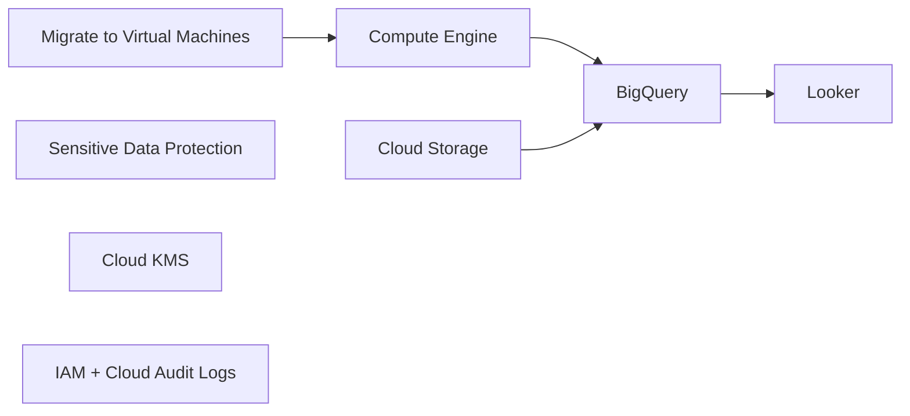

# Proposta técnica (RASCUNHO) – Empresa Exemplo S.A. (fictícia)

> Gerado automaticamente em 14/11/2026. **Não enviar ao cliente sem revisão humana.**

## 1. Contexto e dores
- O contrato do nosso data center vence em junho e a renovação ficou cara.
- Hoje os relatórios de vendas são montados de forma manual em planilhas.

## 2. Requisitos
- Temos dados de clientes, então a LGPD é obrigatória em qualquer desenho.
- Hoje os relatórios de vendas são montados de forma manual em planilhas.

## 3. Restrições
- O CFO, e o orçamento só é liberado no primeiro trimestre.

**Prazo crítico:** junho
**Decisores:** CFO, CIO

## 4. Arquitetura de referência (rascunho)

| Serviço | Camada | Por quê |
|---|---|---|
| Migrate to Virtual Machines | origem | Migração das cargas do data center atual |
| Compute Engine | computacao | Destino das VMs migradas |
| BigQuery | dados | Data warehouse para análise |
| Looker | analytics | Painéis para as áreas de negócio |
| Cloud Storage | dados | Armazenamento de objetos e backup |
| Sensitive Data Protection | seguranca | Descoberta e mascaramento de dados pessoais (LGPD) |
| Cloud KMS | seguranca | Chaves de criptografia gerenciadas pelo cliente |
| IAM + Cloud Audit Logs | seguranca | Menor privilégio e trilha de auditoria |

## 5. Investimento
Estimar na calculadora oficial (https://cloud.google.com/products/calculator) com volumes confirmados pelo cliente.
Este rascunho não contém preços.

## 6. Próximos passos
- O CIO quer ver uma prova de conceito antes.
- Sim, vamos marcar o workshop para a próxima semana.

## 7. Checklist de revisão
- [ ] Arquitetura revisada por especialista
- [ ] Custos estimados e validados na calculadora oficial do Google Cloud
- [ ] Premissas e riscos descritos
- [ ] Requisitos regulatórios (ex.: LGPD) tratados no desenho
- [ ] Proposta aprovada para envio ao cliente
